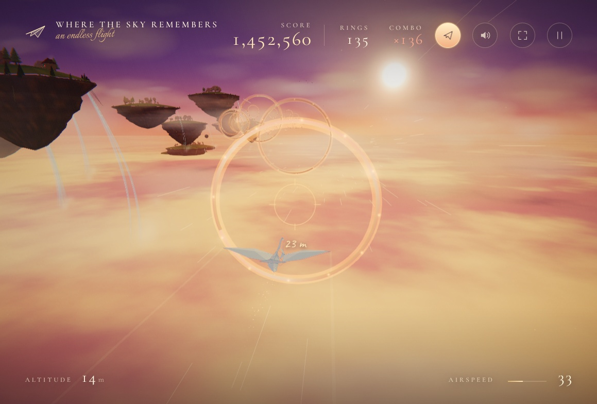
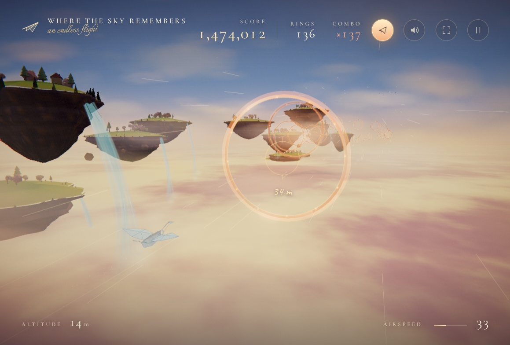
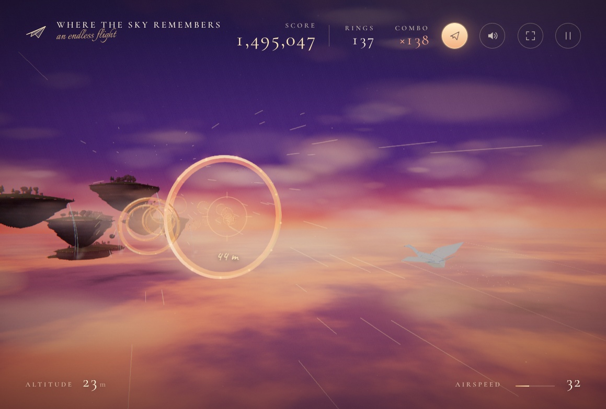
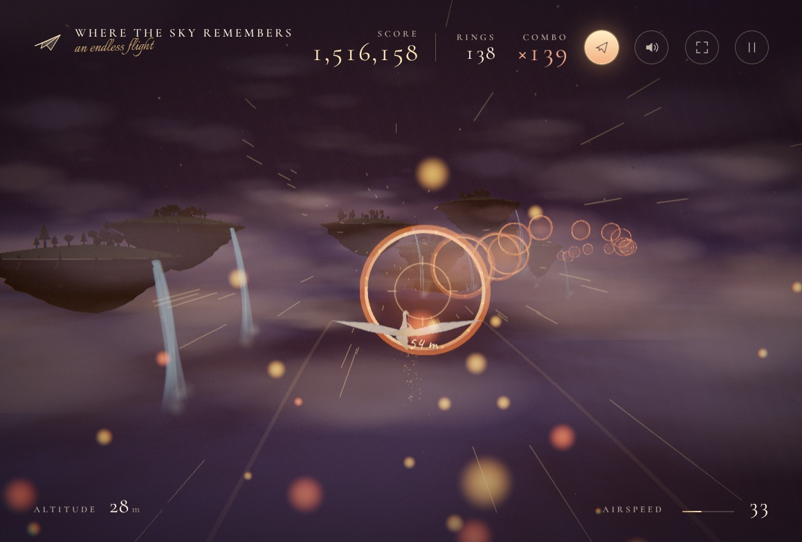

# Where the Sky Remembers

A hand-painted, storybook flight through procedurally generated floating islands. Fold a paper plane, follow the golden rings, chain combos, and watch the sky drift from golden hour through night and back again.

## Features

- Procedural floating islands, waterfalls, clouds, birds, and golden rings
- Three selectable paper planes: a classic dart, a broad-winged glider, and an origami crane
- Paper-fold morph transitions between planes
- Auto-flight that threads rings for you
- Optional cinematic pan-and-tilt follow camera after one minute of idle time
- Day-to-night cycle with stars, moonlight, shifting fog, and changing lighting
- Synthesized audio, mute persistence, scoring, combos, and endless ring spawning
- Responsive HUD for desktop and smaller screens

## Screenshots

Captured in-game across the full day-night cycle.

| **Golden hour** | **Daylight** |
| --- | --- |
|  |  |
| **Dusk** | **Deep night** |
|  |  |

## Fly-by Videos

Two ten-second, HUD-free fly-bys captured from the game canvas. Click a poster to open the MP4.

| Day fly-by | Night fly-by |
| --- | --- |
| <video width="630" height="300" src="https://github.com/user-attachments/assets/8365fc03-22da-4469-b479-40c40d8dbafd.mp4"></video> | <video width="630" height="300" src="https://github.com/user-attachments/assets/ca5de8df-dd95-46f4-9521-d86a0ba6f53d.mp4"></video> |
| [](media/videos/day-flyby.mp4) | [](media/videos/night-flyby.mp4) |

All media lives in `media/`. The clips are 10 seconds, 30 fps, H.264 MP4.

## Controls

| Input | Action |
| --- | --- |
| `WASD` / arrow keys | Steer |
| `Shift` | Hold to soar / boost |
| `1` `2` `3` | Choose a paper plane |
| `F` | Toggle auto-flight |
| `[` / `]` | Adjust auto-flight idle delay |
| `M` | Mute / unmute |
| `Esc` / `P` | Pause |
| `H` | Show flight controls |

### Auto-flight camera

- `WASD` in auto-flight: high / left / low / right camera
- Press the same direction again: close-up / long shot
- One minute of idle time in auto-flight: cinematic pan-and-tilt follow

## Tech

- [Three.js](https://threejs.org/) for the 3D world
- [Vite](https://vite.dev/) for development and builds
- Web Audio API for synthesized sound
- Fontsource for the bundled display fonts
- All textures and audio are generated locally; there are no external asset requests

## Run Locally

Requires Node.js 20.19+ or 22.12+.

```bash
npm install
npm run dev
```

Open the local URL printed by Vite. The dev server is configured to listen on `0.0.0.0`.

## Build

```bash
npm run build
npm run preview
```

The production build is written to `dist/`.

## Deploy to GitHub Pages

This repository includes `.github/workflows/deploy.yml`, which builds and deploys the site with GitHub Actions.

1. Push the repository to GitHub.
2. Open **Settings → Pages**.
3. Under **Build and deployment**, choose **Source: GitHub Actions**.
4. Push to `main` or run the workflow manually from the **Actions** tab.

`vite.config.js` uses a relative base so the same build works both at a custom domain and at a GitHub Pages project URL such as `https://username.github.io/repository/`.

## Project Structure

```text
.
├── index.html
├── package.json
├── package-lock.json
├── vite.config.js
├── media/
│   ├── screenshots/
│   │   ├── 01-golden-hour.jpg
│   │   ├── 02-daylight.jpg
│   │   ├── 03-dusk.jpg
│   │   └── 04-night.jpg
│   └── videos/
│       ├── day-flyby.mp4
│       └── night-flyby.mp4
├── src/
│   ├── audio.js
│   ├── main.js
│   ├── plane.js
│   ├── style.css
│   ├── utils.js
│   └── world.js
└── .github/workflows/deploy.yml
```

## Built with AI

This project was made by AI using:

- **Tool:** OpenCode
- **Model:** DeepSeek V4.1 Flash Free

## License

MIT — see [LICENSE](LICENSE).
